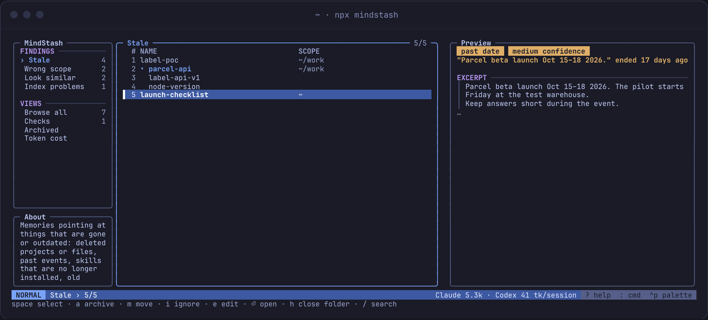
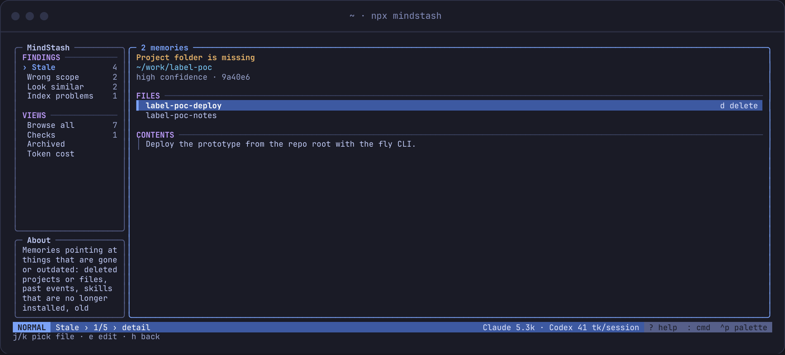
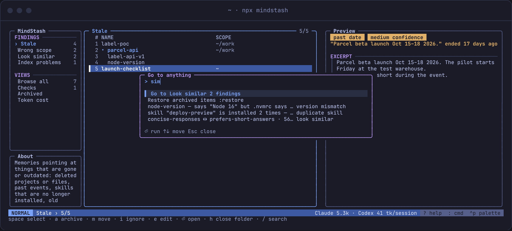

# MindStash

**See, scope and clean up what your AI agents know.**

Coding agents (Claude Code, Codex, Cursor, Gemini CLI, ...) save memories and load skills on their own. Over time these pile up: some go stale, some land in the wrong scope, some repeat or contradict each other, and the user has no single place to see or fix them. MindStash scans that setup, explains what looks wrong, and helps clean it up, while leaving each agent's own memory system untouched.

Works with **Claude Code** and **Codex**. Needs Node 20+ and git (for backups).



<details><summary>More screenshots</summary>




</details>

The UI is vim-style: `j/k`, `gg/G`, `h/l` between panes, `/` search, `:` commands, `Ctrl-P` palette, `?` for all keys. Run `:tour` to replay the quick tour.

## Use it

```sh
npx mindstash              # interactive terminal UI (plain report when piped)
npx mindstash scan         # plain report; --json for scripts and agents
npx mindstash show <id>    # why something was flagged, with the file
npx mindstash cost         # tokens loaded per session, per agent and project
npx mindstash --theme light
```

The terminal UI opens with the last saved scan when available and refreshes it in the background. The local cache contains previews and is readable only by your account by default. The theme defaults to `auto`, which uses `COLORFGBG` when supplied and falls back to Tokyo Night. Presets include `light`, `tokyo-night`, `catppuccin`, `gruvbox`, and `high-contrast`. Set `NO_COLOR=1` to disable colors.

Nothing changes without confirmation. Fixes are backed up to a git repo in `~/.mindstash/backups` and can be undone:

```sh
npx mindstash apply --delete <id> --archive <id> --move <id> --ignore <id> --relink <id>
npx mindstash apply --move <id> --to <folder>
npx mindstash undo
npx mindstash archived            # what was archived
npx mindstash restore <id>        # put it back
```

Ids can be finding ids or item ids, so any memory or skill you own can be deleted or archived directly (skills as whole folders). Press `m` on a Claude Code memory or a finding over Claude Code memories to choose the destination project and review the move. Plugin skills, Codex's bundled skills and Codex-generated memories stay read-only.

Use it from inside your agent:

```sh
npx mindstash install-skill        # adds /mindstash (Claude Code) and $mindstash (Codex)
npx mindstash install-statusline   # optional: "🧠 2 new · 76 to review" in Claude Code's status line
npx mindstash install-hook         # optional: a one-line note at session start when something new is flagged
```

Both optional installs add to `~/.claude/settings.json` without replacing what's there (a backup is kept), and `--remove` takes them out. They read the cached scan, so they never slow a session down.

`apply` uses finding and item ids from the latest scan for these fixes, and refuses files that changed since that scan.

Contradictions need judgment, so MindStash only finds candidate pairs (same session, same topic, one side says "never" or names a different version). Your agent judges them through the skill, with no API key:

```sh
npx mindstash check --json                      # pairs that may disagree
npx mindstash judge <id> --conflict "<how>"     # or --duplicate "<why>", --ok
```

A verdict is dropped automatically when either file changes.

### What it flags

| Rule | Confidence | Meaning |
|---|---|---|
| missing-project | high | memories for a project folder that's gone |
| missing-path | high | mentions a file or folder that no longer exists (partial paths matched against the repo's git files; gitignored paths skipped) |
| past-event | medium | a date that was upcoming when the memory was saved and has passed |
| wrong-scope | medium | a note about one project saved in a parent folder like `~` (can be moved) |
| similar / skill-duplicate / skill-overlap | medium–high | near-duplicate memories, skills installed twice; suggest only, never merged |
| relearned | medium | similar to a memory you deleted with MindStash |
| too-long / broken-link / unindexed | high–medium | `MEMORY.md` over 200 lines, links to missing files, memory files it doesn't list (fix: link them back in) |
| agents-too-long | high | Codex `AGENTS.md` files for a folder over the 32 KiB Codex reads |
| instructions-too-big | medium–high | a CLAUDE.md / AGENTS.md over ~4,000 tokens (loaded in full every session), with its biggest and log-like sections |
| broad-instructions | medium | a CLAUDE.md in a parent folder (like `~`) that loads in every project below it |
| missing-skill | high | a memory says "run `/x`" but `/x` isn't installed |
| version-mismatch | medium | a memory says "Node 16" but the repo declares 22 (package.json, .nvmrc, go.mod, …) |
| codex-skill-budget | low | Codex skill descriptions past the documented listing budget |
| contradiction / duplicate-checked | medium | two notes that load together disagree or repeat each other, as judged by your agent (see below) |

Codex memories (`~/.codex/memories`) are generated by Codex, so MindStash only flags and explains them; fixes (delete, archive, move) apply to Claude Code memories.

### Develop

```sh
npm install && npm run build
node dist/cli.js scan
npm test          # vitest, with fake ~/.claude folders built per test
npm run typecheck
npm run dev -- scan
npm run site:screens   # re-render the landing page's terminal screens from the real UI
```

After refreshing the site screens, run `npx tsx scripts/screenshots.tsx` to export the same terminal views as README PNGs. The export uses a local Google Chrome installation.

Env: `CLAUDE_CONFIG_DIR` (default `~/.claude`), `CODEX_HOME` (default `~/.codex`), `MINDSTASH_HOME` (default `~/.mindstash`).

Code: `src/core` (scan, rules, fixes, backup; agent-agnostic), `src/adapters` (one per agent), `src/cli`, `src/tui` (Ink screens, loaded only for the interactive UI), `site` (static landing page, no build step; open `site/index.html` through any static server).

## Docs

- [docs/idea.md](docs/idea.md): concept, decisions so far, open questions
- [docs/stack.md](docs/stack.md): tech stack (TypeScript, Ink, npx)
- [docs/ui.md](docs/ui.md): screens, agent skill, CLI commands
- [docs/staleness.md](docs/staleness.md): flagging rules and confidence levels
- [docs/research/findings.md](docs/research/findings.md): existing tools and gaps (Oct 22, 2026)
- [docs/research/notes.md](docs/research/notes.md): competitor checks and naming research
